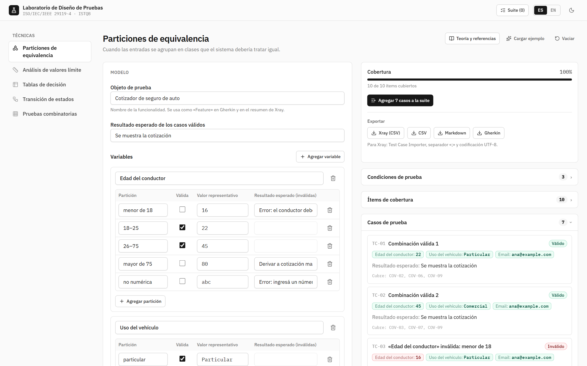
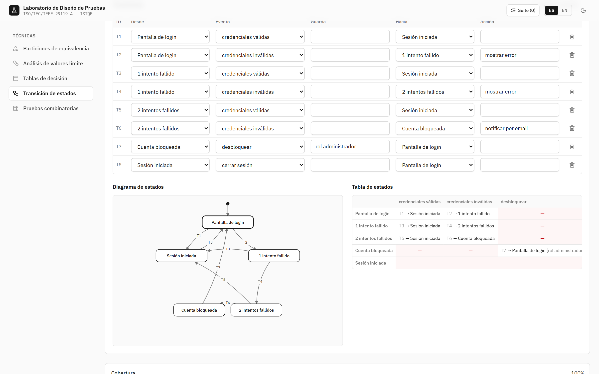
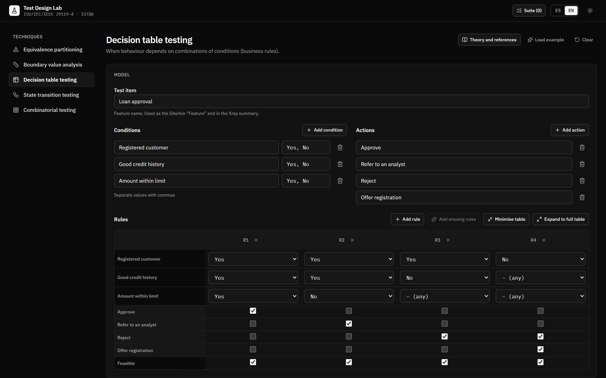
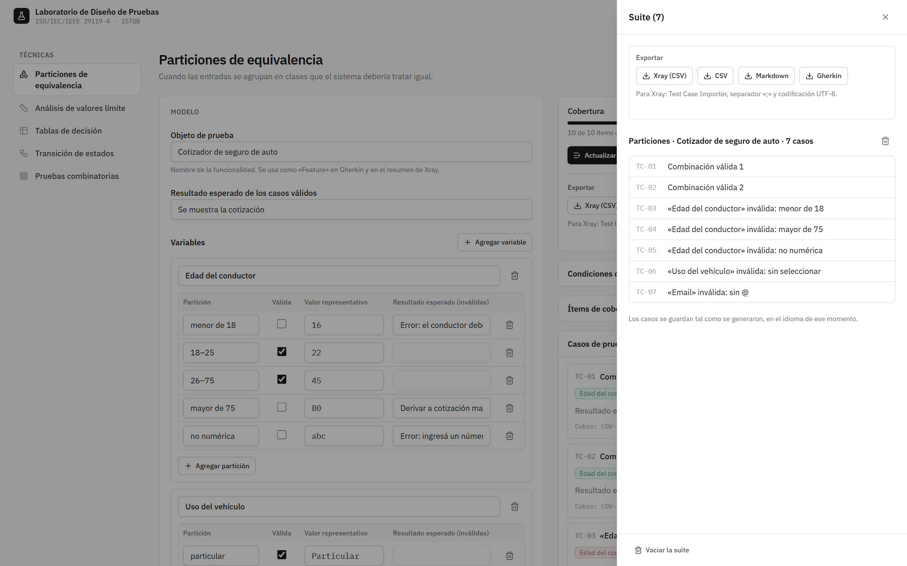

# Laboratorio de Diseño de Pruebas

[](https://github.com/anagonzalezlame/test-design-lab/actions/workflows/ci.yml)


[English](README.md) · **Español**

Un laboratorio bilingüe (español / inglés) de **diseño de pruebas basado en la especificación**. Modelás el sistema y el laboratorio deriva **condiciones de prueba → ítems de cobertura → casos de prueba** siguiendo **ISO/IEC/IEEE 29119-4** y los syllabus de **ISTQB**. Además, mide la cobertura y exporta los casos a **Xray, CSV, Markdown y Gherkin**.

Funciona por completo en el navegador: sin cuentas ni servidor, y tus modelos no salen de tu computadora.



## Técnicas

| Técnica | Qué modelás | Qué genera el laboratorio | Criterios de cobertura |
| --- | --- | --- | --- |
| **Particiones de equivalencia** | Variables divididas en particiones válidas e inválidas | Combina las válidas y **aísla cada partición inválida** en su propio caso, para que un error no enmascare a otro | Particiones ejercitadas / identificadas |
| **Análisis de valores límite** | Un dominio ordenado con particiones contiguas y un incremento de precisión | Límites de **2 o 3 valores**, con aritmética decimal exacta. Rechaza huecos y superposiciones | Ítems límite ejercitados / identificados |
| **Tablas de decisión** | Condiciones (booleanas o de entrada extendida), acciones y reglas con «–» | Detecta **contradicciones, redundancias y combinaciones faltantes**. Completa, **minimiza** y expande la tabla | Reglas factibles ejercitadas / reglas factibles |
| **Transición de estados** | Estados, eventos, guardas, acciones y estado inicial | Diagrama, tabla de estados completa y caminos de prueba. Avisa de estados inalcanzables y de no determinismo | Todos los estados · transiciones válidas (0-switch) · todas las transiciones (incluidas las inválidas) · 1-switch |
| **Pruebas combinatorias** | Parámetros, valores y combinaciones prohibidas | **Pairwise (IPOG)**, each choice y base choice, con restricciones y de forma determinística | Pares factibles / valores / variaciones base |

Cada técnica tiene un **panel de teoría** (procedimiento, fórmulas de cobertura, errores frecuentes y referencias) redactado para este laboratorio, y un ejemplo listo para usar.

| Transición de estados | Tabla de decisión (tema oscuro) |
| --- | --- |
|  |  |

## Exportación

Podés juntar casos de cualquier técnica en la **suite** y exportarlos juntos, o exportar directamente la técnica actual.

| Formato | Detalle |
| --- | --- |
| **Xray (CSV)** | Formato del **Test Case Importer** de Xray: separador `;`, `Issue Id` agrupa las filas de un test, `Test Type` = `Manual` y una fila por paso con `Action`, `Data` y `Result`. Importalo con codificación UTF-8. En Xray Server/DC mapeás las mismas columnas (Test Type puede quedar sin mapear). |
| **CSV** | Una fila por caso, UTF-8 con BOM para que Excel muestre bien los acentos. Sirve para planillas y otras herramientas de gestión de pruebas. |
| **Markdown** | Una tabla por objeto de prueba, lista para una wiki, un pull request o un plan de pruebas. |
| **Gherkin (.feature)** | Los casos basados en datos se convierten en un `Esquema del escenario` con su tabla de `Ejemplos` alineada. Los caminos de transición de estados se convierten en `Escenario`s con pasos Cuando/Entonces. En español lleva `# language: es`. Cada archivo tiene una sola `Característica`. |



## Cómo levantarlo en local

Requisitos: [Node.js](https://nodejs.org/) 20.19 o superior y npm.

```bash
git clone https://github.com/anagonzalezlame/test-design-lab.git
cd test-design-lab
npm install
npm run dev
```

Después abrí <http://localhost:5173>. Para generar una versión estática para cualquier hosting estático:

```bash
npm run build     # genera dist/
npm run preview   # sirve el build en local
```

## Calidad y rigor

Una herramienta de diseño de pruebas tiene que acertar, así que el motor está probado con más exigencia que la interfaz:

| Capa | Herramienta | Qué cubre |
| --- | --- | --- |
| Estática | TypeScript (strict), oxlint | Tipos y reglas de lint, sin advertencias |
| Basadas en propiedades | Vitest + [fast-check](https://fast-check.dev) | Cientos de modelos aleatorios por propiedad. Por ejemplo: pairwise nunca deja un par factible sin cubrir ni viola una restricción; minimizar una tabla de decisión nunca cambia su comportamiento; cada caso de transición de estados es un camino real desde el estado inicial; los límites siempre caen en el borde de una partición |
| Unitarias | Vitest | Ejemplos de referencia con resultado conocido para cada técnica, decimales exactos, lectura de vuelta del CSV, estructura del Gherkin, formato de Xray, rendimiento (10 parámetros × 5 valores en milisegundos) |
| Integración | Testing Library | Navegación, regeneración del diseño al editar el modelo, detección de contradicciones, actualización de la suite, cambio de idioma |
| End-to-end | Playwright | Cobertura completa de cada ejemplo, panel de teoría, descargas de Xray y Gherkin, una suite de dos técnicas exportada como una sola Característica, persistencia al recargar, sin scroll horizontal a 375 px |

Cada push y pull request corre toda la suite en GitHub Actions.

```bash
npm run lint
npm test                          # propiedades, unitarias e integración
npx playwright install chromium   # solo la primera vez
npm run e2e                       # end-to-end (compila y levanta la app)
npm run screenshots               # regenera las capturas (con la app levantada; usá BASE_URL)
```

## Referencias

- ISO/IEC/IEEE 29119-4: *Software and systems engineering — Software testing — Part 4: Test techniques*
- ISTQB Certified Tester Foundation Level v4.0, sección 4.2 (técnicas de caja negra)
- ISTQB Certified Tester Advanced Level, Test Analyst (pruebas combinatorias)
- Y. Lei y K. C. Tai (1998), *In-parameter-order: a test generation strategy for pairwise testing*
- Y. Lei et al. (2007), *IPOG: a general strategy for t-way software testing*

Las explicaciones de la app están redactadas con palabras propias; consultá las normas y syllabus para el texto oficial.

## Stack

Vite · React 19 · TypeScript · Tailwind CSS v4 · Zustand · Lucide · Vitest · fast-check · Testing Library · Playwright

La estructura de carpetas está en el [README en inglés](README.md#tech-stack). El motor de cada técnica es un módulo puro, sin código de interfaz, con sus propias pruebas.

## Parte de un toolkit de QA

Complementa al [Asistente de Planes de Prueba](https://github.com/anagonzalezlame/test-plan-wizard): primero planificás las pruebas con el asistente y después diseñás los casos acá.

## Sobre mí

Soy **Ana González Lamé**, Senior QA Analyst de Uruguay (ISTQB CTFL), con más de diez años en tecnología. Trabajo en estrategia de pruebas, testing exploratorio y funcional, escenarios BDD en Gherkin y pruebas de API.

🟢 **Disponible para posiciones de QA remotas.** Hablemos: [LinkedIn](https://www.linkedin.com/in/anagonzalezlame/) · [anagonzalez.uy](https://www.anagonzalez.uy) · [CV interactivo](https://www.anagonzalez.cv)

## Licencia

[MIT](LICENSE) © 2026 Ana González Lamé
