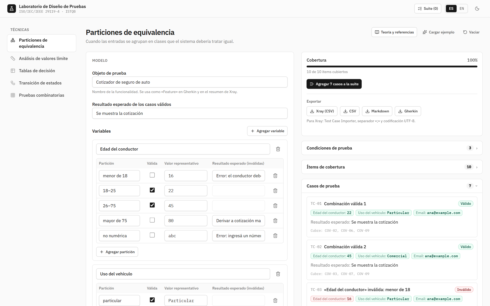
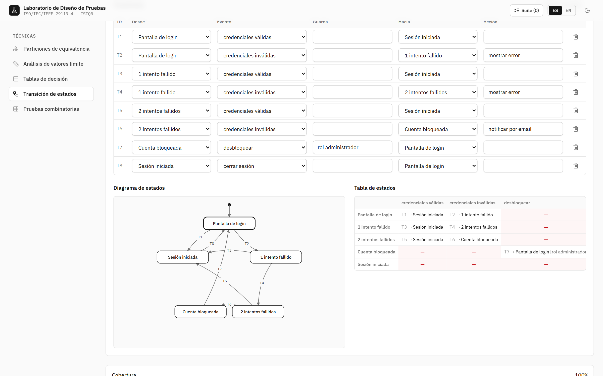
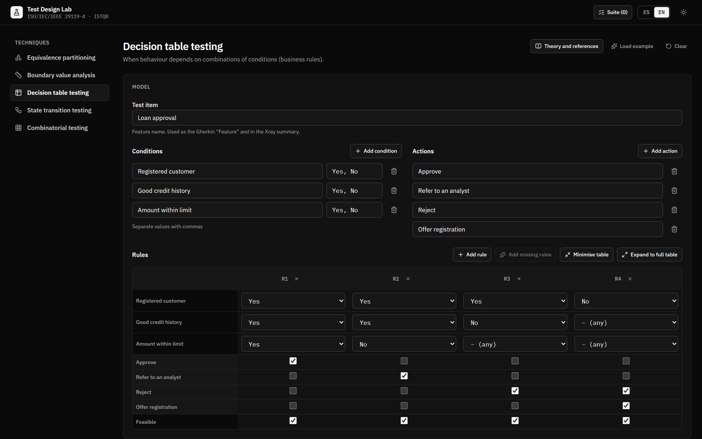
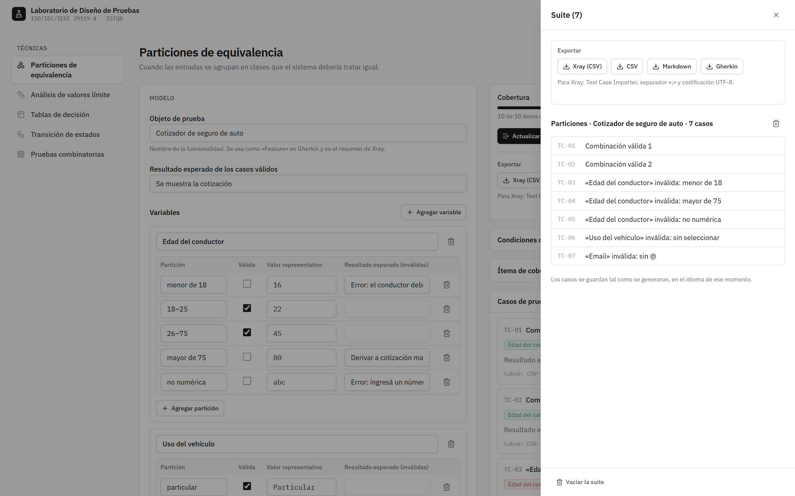

# Test Design Lab

[](https://github.com/anagonzalezlame/test-design-lab/actions/workflows/ci.yml)


**English** · [Español](README.es.md)

A bilingual (Spanish / English) lab for **specification-based test design**. Model the system, and the lab derives **test conditions → coverage items → test cases** following **ISO/IEC/IEEE 29119-4** and the **ISTQB** syllabi, measures coverage, and exports the cases to **Xray, CSV, Markdown and Gherkin**.

It runs entirely in the browser: no account, no backend, and your models never leave your machine.



## Techniques

| Technique | What you model | What the lab generates | Coverage criteria |
| --- | --- | --- | --- |
| **Equivalence partitioning** | Variables split into valid and invalid partitions | Valid partitions combined; **each invalid partition isolated** in its own case so faults cannot mask each other | Partitions exercised / identified |
| **Boundary value analysis** | An ordered domain with contiguous partitions and a precision step | **2-value** or **3-value** boundaries, with exact decimal arithmetic; gaps and overlaps are rejected | Boundary items exercised / identified |
| **Decision table testing** | Conditions (boolean or extended entry), actions and rules with “–” | Detects **contradictions, redundancies and missing combinations**; completes, **minimises** and expands the table | Feasible rules exercised / feasible rules |
| **State transition testing** | States, events, guards, actions and the initial state | State diagram, full state table and test paths; warns about unreachable states and non-determinism | All states · valid transitions (0-switch) · all transitions (incl. invalid) · 1-switch |
| **Combinatorial testing** | Parameters, values and forbidden combinations | **Pairwise (IPOG)**, each choice and base choice, constraint aware and deterministic | Feasible pairs / values / base-choice variations |

Every technique has a **theory panel** (procedure, coverage formulas, common mistakes and references) written for this lab, plus a ready-made example.

| State transitions | Decision table (dark theme) |
| --- | --- |
|  |  |

## Export

Add cases from any technique to the **suite** and export them together, or export the current technique directly.

| Format | Details |
| --- | --- |
| **Xray (CSV)** | Layout of Xray's **Test Case Importer**: `;` delimiter, `Issue Id` groups the rows of a test, `Test Type` = `Manual`, one row per step with `Action`, `Data` and `Result`. Import it with UTF-8 encoding; on Xray Server/DC map the same columns (Test Type can be left unmapped). |
| **CSV** | One row per case, UTF-8 with BOM so Excel shows accents. Works for spreadsheets and other test management tools. |
| **Markdown** | One table per test item, ready for a wiki, a pull request or a test plan. |
| **Gherkin (.feature)** | Data-driven cases become a `Scenario Outline` with an aligned `Examples` table; state transition paths become `Scenario`s with When/Then steps. Spanish files use `# language: es`. A file always holds a single `Feature`. |



## Getting started

Requirements: [Node.js](https://nodejs.org/) 20.19 or later and npm.

```bash
git clone https://github.com/anagonzalezlame/test-design-lab.git
cd test-design-lab
npm install
npm run dev
```

Then open <http://localhost:5173>. To build a static version for any static host:

```bash
npm run build     # output in dist/
npm run preview   # serve the build locally
```

## Quality and rigour

A test design tool has to be right, so the engine is tested harder than the UI:

| Layer | Tooling | What it covers |
| --- | --- | --- |
| Static | TypeScript (strict), oxlint | Types and lint rules, zero warnings |
| Property-based | Vitest + [fast-check](https://fast-check.dev) | Hundreds of random models per property. For example: pairwise never misses a feasible pair and never violates a constraint; minimising a decision table never changes its behaviour; every state-transition test is a real path from the initial state; boundaries always fall on partition edges |
| Unit | Vitest | Reference examples with known results for every technique, exact decimals, CSV round-trip parsing, Gherkin structure, Xray layout, performance (10 parameters × 5 values in milliseconds) |
| Integration | Testing Library | Navigation, model edits regenerating the design, contradiction detection, suite updates, language switch |
| End-to-end | Playwright | Full coverage of every example, theory panel, Xray and Gherkin downloads, a two-technique suite exported as one Feature, persistence after reload, no horizontal overflow at 375 px |

Every push and pull request runs the whole suite on GitHub Actions.

```bash
npm run lint
npm test                          # property-based, unit and integration
npx playwright install chromium   # first time only
npm run e2e                       # end-to-end (builds and serves the app)
npm run screenshots               # regenerate README screenshots (serve the app first; set BASE_URL)
```

## References

- ISO/IEC/IEEE 29119-4: *Software and systems engineering — Software testing — Part 4: Test techniques*
- ISTQB Certified Tester Foundation Level v4.0, section 4.2 (black-box test techniques)
- ISTQB Certified Tester Advanced Level, Test Analyst (combinatorial testing)
- Y. Lei and K. C. Tai (1998), *In-parameter-order: a test generation strategy for pairwise testing*
- Y. Lei et al. (2007), *IPOG: a general strategy for t-way software testing*

The explanations in the app are written in my own words; see the standards and syllabi for the official text.

## Tech stack

Vite · React 19 · TypeScript · Tailwind CSS v4 · Zustand · Lucide · Vitest · fast-check · Testing Library · Playwright

```
src/
├── engine/        one pure module per technique + its tests (no UI code)
├── lib/           export formats, helpers
├── components/
│   ├── editors/   model editor per technique, state diagram
│   ├── results/   coverage, issues, conditions, items, cases
│   ├── export/    download menu
│   └── layout/    header, navigation, technique page, suite
├── i18n/          UI text and theory (es, en)
├── data/          example models
└── store/         Zustand store with persistence
```

## Part of a QA toolkit

Companion to [Test Plan Wizard](https://github.com/anagonzalezlame/test-plan-wizard): plan the testing with the wizard, then design the cases here.

## About the author

I'm **Ana González Lamé**, a Senior QA Analyst from Uruguay (ISTQB CTFL) with over a decade in tech. I work on test strategy, exploratory and functional testing, BDD scenarios in Gherkin and API testing.

🟢 **Open to remote QA roles.** Let's talk: [LinkedIn](https://www.linkedin.com/in/anagonzalezlame/) · [anagonzalez.uy](https://www.anagonzalez.uy) · [Interactive CV](https://www.anagonzalez.cv)

## License

[MIT](LICENSE) © 2026 Ana González Lamé
